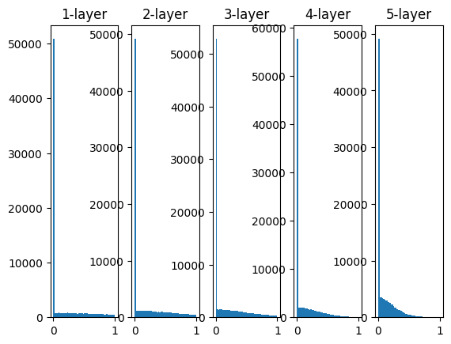
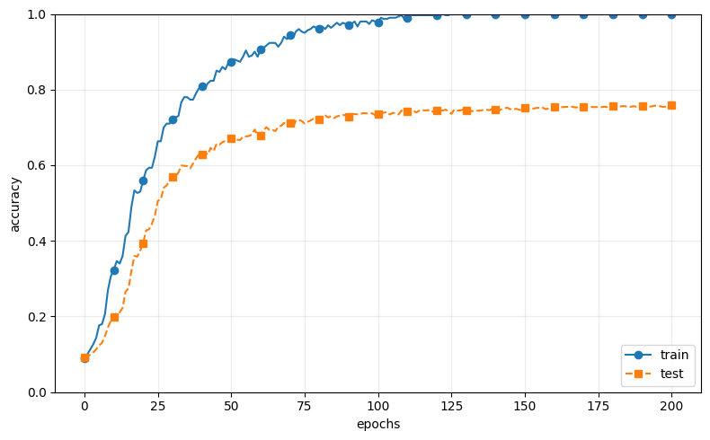
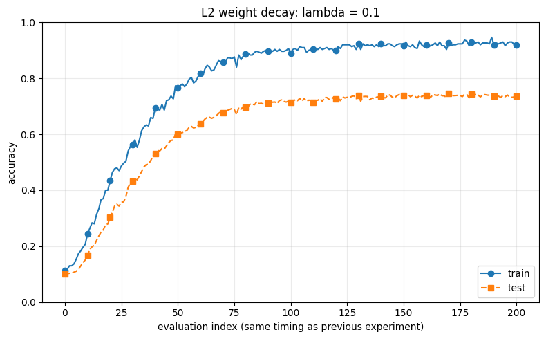
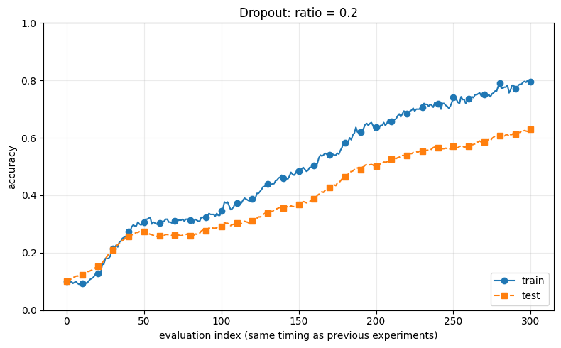

# 第6章：与学习相关的技巧

[返回学习导航](00-学习导航.md) · [上一章：误差反向传播法](05-误差反向传播法.md)

整理日期：2026-11-06。**第六章已完成。** 本章把参数更新、权重初始化、Batch Normalization、正则化与超参数验证连起来，结合自己的代码和实验回查。

HTML：[第六章总结与速查](../../reference/chapter6.html) · [MultiLayerNet代码手册](../../reference/multi-layer-net.html) · [Dropout速查](../../reference/dropout.html) · [参数与层短练习](../../lessons/0012-multilayernet-parameters.html) · [一次更新短练习](../../lessons/0013-multilayernet-training.html) · [Dropout短练习](../../lessons/0014-dropout-mask.html)。

## 本章学习回顾

| 内容 | 当前状态 |
| --- | --- |
| 6.1 参数更新 | 已写SGD、Momentum、AdaGrad、Adam；Adam目前以知道如何使用为目标 |
| 6.2 权重初始化 | 已讨论标准差、Xavier、He和激活值分布；已运行前向直方图实验 |
| 6.3 Batch Normalization | 已读概念和对比图；自己的网络尚未加入BN |
| 6.4.1 过拟合 | 已写基础MultiLayerNet，用300个训练样本训练并保存准确率曲线 |
| 6.4.2 权值衰减 | 已运行L2实验，讨论正则项、梯度与训练/测试曲线 |
| 6.4.3 Dropout | 已运行Dropout实验，保存训练与测试准确率曲线 |
| 6.5 超参数验证与最优化 | 已阅读；本节选择不实际敲代码，之后有调参需求时再回查 |
| 6.6 小结 | 用全章主线回顾学习技巧，接下来进入第7章CNN |

基础网络保存在`common/multi_layer_net.py`；L2与Dropout通过Notebook中的子类扩展。回查代码时，可先看层宽与参数，再看`loss → gradient → optimizer.update`。

## 6.1：反向传播与优化器的分工

```python
grads = network.gradient(x_batch, t_batch)  # 计算梯度
optimizer.update(network.params, grads)    # 更新参数
```

- `params`保存W和b，两者都需要学习；`x`是输入数据，不由普通优化器修改。
- `grads`保存损失对各参数的梯度，键与参数对应，形状相同。
- SGD：`params[key] -= lr * grads[key]`。
- Momentum：保存历史更新步长v；先更新v，再用`params[key] += v[key]`。
- AdaGrad：保存梯度平方的累计值h，用它缩放后续更新步长。
- Adam：保存梯度和梯度平方的指数加权历史，再做偏差校正。当前只要求能使用；[公式与代码](../../reference/adam.html)留待回查，不强制完成推导或旧题。

历史数组与参数同形，通常在第一次调用时用`np.zeros_like(val)`初始化。初始化放在`if ... is None`内，实际更新放在外面，避免每次清空历史。

## 6.2：初始化实验观察什么

前向实验从随机输入出发，计算5层输出，保存到`activations`后画直方图。循环每轮对应一个不同的层，生成本层权重；没有损失、反向或参数更新。你已经主动指出这不是学习过程，见[学习记录0012](../../learning-records/0012-initialization-without-training.md)。

```python
z = np.dot(x, w)
a = sigmoid(z)  # 后来换成relu(z)作比较
activations[i] = a
```

每层1000个样本、每样本100个输出，所以一幅图统计100000个激活值。横轴是输出数值，纵轴是落入区间的个数；不是权重本身，也不是准确率。

| 权重采样尺度 | 写法 | node_num=100时的标准差 |
| --- | --- | --- |
| 固定1 | `randn(...) * 1` | 1 |
| 固定0.01 | `randn(...) * 0.01` | 0.01 |
| 本实验Xavier | `randn(...) / np.sqrt(node_num)` | 0.1 |
| He | `randn(...) * np.sqrt(2.0 / node_num)` | 约0.1414 |

输入节点数决定尺度。0.01初始化在第五章的浅网络中可以成功训练，不等于在所有深度和设置下都同样合适。

### sigmoid与梯度消失

设`a=sigmoid(z)`，局部导数是`a*(1-a)`。a=0.5时导数0.25；a=0.99或0.01时为0.0099。你第五章写过的`dx = dout * (1-self.out) * self.out`，就是乘上这一局部导数。

反向传播连续经过小导数，可能让靠前层的梯度很小，更新几乎不动。实际网络还包含权重乘法和分支求和；直方图只是提示前向是否进入饱和区，不直接测量梯度。

### ReLU图怎样看

ReLU把负值归零，因而零附近的高柱正常。比较三种初始化时，重点看剩下正值的分布是否逐层向0收缩：标准差0.01时迅速收缩，Xavier时渐缩，He较能保持尺度。正输入处ReLU导数为1，即使输出很小也如此，不能直接套用sigmoid的饱和解释。

当前Notebook保存的是**ReLU + Xavier、50个区间、显示0到1范围**的图；不是He对比图。ReLU可以输出大于1的值，图里的范围不代表其输出上界。



上图直接来自本次Notebook保存输出。零附近柱很高，其余柱在当前纵轴下显得较小。[逐行解释与读图](../../reference/activation-distribution.html)。

## 6.3：为什么无BN对照组比之前训练低

图例`Normal (without BatchNorm)`指“不使用BN的对照组”，不是初始化方法名。自己的第五章网络为784→50→10、W标准差0.01、b为0；它与教材配套BN脚本的5隐藏层、1000个训练样本、多种初始化尺度和短训练配置不同，不能只按准确率直接比较。

BN帮助降低网络对初始化尺度的敏感性，并可使学习更顺利；不用BN也能得到高准确率。本章这部分以阅读概念与比较实验为主，没有自己实现BN。

### BN具体调整什么

对mini-batch中同一特征的值，先求均值与方差，再标准化，最后进行可学习的缩放和平移：

\[
\hat{x}=\frac{x-\mu_B}{\sqrt{\sigma_B^2+\varepsilon}},\qquad y=\gamma\hat{x}+\beta
\]

`γ`与`β`是网络学习的参数，`ε`用于避免除零。这里调整的是网络中间数据的分布，与把输入图片除以255不是同一项处理。教材示意顺序为`Affine → BatchNorm → ReLU`，见PDF209—211页。

另一个代码衔接点：学习率以实际优化器对象的`lr`为准。写了`learning_rate=0.1`，但创建`SGD()`使用默认0.01时，前面的变量不会自动生效。

## MultiLayerNet：把已有层连成可配置网络

自己的文件是[common/multi_layer_net.py](../../mycode/common/multi_layer_net.py)，基础层在[layers.py](../../mycode/common/layers.py)。

以已经跑通的`MultiLayerNet(4, [3,5], 2)`为例：

1. `[4]+[3,5]+[2]`拼接出层宽列表。
2. 相邻项产生W1(4,3)、W2(3,5)、W3(5,2)，偏置长度分别为3、5、2。
3. 把参数交给Affine对象，建立`Affine1 → Relu1 → Affine2 → Relu2 → Affine3`。
4. `predict`依次执行forward，6个样本返回(6,2)得分；得分可以为负。
5. `loss`在得分后调用SoftmaxWithLoss，返回标量。
6. `gradient`先loss刷新缓存，再逆序backward，收集每个Affine的dW/db。
7. 优化器在类外修改params；Affine使用的参数数组随之更新。

| 容器 | 保存什么 |
| --- | --- |
| `self.params` | 可学习的W和b数组 |
| `self.layers` | 按计算顺序保存的层对象 |
| `self.last_layer` | 单独接收得分和标签的损失层 |
| `grads` | 各个参数对应的梯度数组 |

params里的W与对应Affine.W指向同一数组。SGD使用原地`-=`，因此下一轮前向会用新参数。这是从“计算梯度”连接到“实际学习”的关键。

你已报告小测试loss约0.7319547、accuracy=0.5以及六组梯度形状正确。这是6个随机样本的接口测试，不是MNIST训练准确率。完整解释和交互维度表见[MultiLayerNet手册](../../reference/multi-layer-net.html)。

当前accuracy与损失层backward按one-hot使用标签，所以MNIST读取保留：

```python
load_mnist(normalize=True, one_hot_label=True)
```

## 6.4.1：300个样本制造过拟合

```python
x_train = x_train[:300]
t_train = t_train[:300]
```

`[:300]`等价于`[0:300]`，保留索引0到299。图片、标签同步取前300项，保持配对；数组切片用在第一维，图片的784个特征保留。语法回查：[第一章基本语法](01-Python入门.md)。

当前实验：6个100神经元隐藏层，加1个10分类输出层；He初始化、无BN或正则化、batch=100、SGD(lr=0.01)。通过较深网络与少量数据，观察训练与测试准确率出现差距。



蓝色train逐渐接近1，橙色test后期约在0.76附近，差距明显。这支持当前实验出现了对训练数据拟合较好、对未见数据泛化不足的现象。数值是从保存图近似读取，没有重新训练，也没有把图像读数当作精确的最终列表数值。

### epoch与保存记录

- `iter_per_epoch=300/100=3`，每隔3次更新评价一次。
- 条件`i % iter_per_epoch == 0`在i=0也触发，所以第一个记录实际在第一次更新后。
- `max_epochs=201`在当前写法中记录201次评价；最后在i=600评价并退出，即总计601次更新。
- 图横轴沿用教材，把这些评价点编号为0到200，不严格等于已经完整走完的epoch数。
- `np.random.choice`默认可重复抽样，因此约3个batch也不保证恰好看遍300个不同样本。

## 6.4.2：权值衰减，让损失也考虑权重大小

本章使用L2正则化，在交叉熵之外加上所有权重元素的平方和：

\[
L=L_{\mathrm{data}}+\frac{\lambda}{2}\sum_i\sum_{j,k}(W_i)_{jk}^2
\]

`λ`控制惩罚强度；本次实现只惩罚W，不惩罚b。`0.5`使平方项求导后正好得到`λW`。对应Notebook中的两处变化：

```python
# loss：累加每一层权重的惩罚
weight_decay += 0.5 * self.weight_decay_lambda * np.sum(W ** 2)

# gradient：在原来的权重梯度上补上正则项的导数
grads[key] = grads[key] + self.weight_decay_lambda * self.params[key]
```

`super().loss(x,t)`调用父类原来的交叉熵计算；循环再取W1、W2……直到输出层的W，逐层累加惩罚。`loss`只计算目标函数，参数仍由优化器更新。

### 本次L2实验与过拟合读图



使用`λ=0.1`、SGD学习率0.01，记录201个评价点。Notebook最后保存的打印为训练准确率**92.00%**、测试准确率**73.55%**。

上面的无正则化实验中，训练接近100%，测试约75%—76%；加入L2后两条线的差距缩小，但测试准确率没有提高。过拟合主要看同一次实验里训练与未见数据的表现差距；不能只凭train从100%降到92%判断效果更好。测试曲线趋平而训练曲线继续上升，也是典型信号，不要求test一定下降。

## 6.4.3：Dropout，随机屏蔽本轮的部分输出

每个隐藏层采用`Affine → ReLU → Dropout`，输出层不加Dropout。训练时随机生成与输入同形的布尔mask；每次前向重新抽取，本轮反向复用同一张mask。

```python
# 训练前向：True保留，False归零
self.mask = np.random.rand(*x.shape) > self.dropout_ratio
out = x * self.mask

# 反向：被屏蔽位置的梯度也为0
dx = dout * self.mask

# 评价：不随机屏蔽，按教材版本乘以保留比例
out = x * (1.0 - self.dropout_ratio)
```

例如`x=[1,2,3,4]`、`mask=[True,False,True,False]`，训练输出为`[1,0,3,0]`。没有删除权重数组，也没有改变输入输出形状。`dropout_ratio=0.2`表示每个位置有约20%的概率被屏蔽，不保证每次恰好屏蔽20%。

训练集准确率和测试集准确率都在评价模式下计算。`train`表示评价的数据来自训练集，不表示计算准确率时开启随机丢弃。本项目沿用教材的缩放方式，不与“训练时除以保留比例、评价时不缩放”的inverted dropout混用。



本次单独使用Dropout，不叠加L2；丢弃比例0.2，SGD学习率0.01，记录301个评价点、901次更新。最后保存的打印为训练准确率**79.67%**、测试准确率**62.98%**。曲线后段仍在上升，这次运行没有得到比前两组更高的测试准确率。正则化方法不保证在任意配置下都提升准确率；各组随机初始化、训练时长也不同，读图时一并考虑。

详细代码见[Notebook](../../mycode/chapter6.ipynb)，机制见[Dropout速查](../../reference/dropout.html)，可选练习见[短课14](../../lessons/0014-dropout-mask.html)。两张新图均从Notebook保存输出提取，没有重新训练。

## 6.5：超参数验证与最优化

本节已阅读，按自己的安排不实际敲代码。回查时抓住以下关系即可。

### 参数与超参数

| 类型 | 例子 | 怎样确定 |
| --- | --- | --- |
| 参数 | W、b；BN的γ、β | 通过训练中的梯度更新学习 |
| 超参数 | 学习率、batch大小、隐藏层宽度、λ、Dropout比例 | 由实验设定，并根据验证结果选择 |

### 训练、验证、测试数据的分工

| 数据 | 用途 |
| --- | --- |
| 训练集 | 计算梯度、学习W和b |
| 验证集 | 比较超参数配置，选择模型 |
| 测试集 | 配置确定后，评价最终泛化表现 |

教材示例先同步打乱图片与标签，再从训练数据中分出20%作为验证数据。20%是示例比例。前面的`test`曲线用于学习时观察泛化差距；正式搜索超参数时，应依据验证集作选择，反复用测试集选配置会使测试结果失去独立评价的作用。

### 随机搜索与对数尺度

1. 先为超参数设定较宽的范围。
2. 随机抽取一组配置，进行较短时间的训练。
3. 比较验证准确率，观察较好配置集中在哪些范围。
4. 缩小范围，再重复搜索，最后选定配置。

教材的学习率示例是在10⁻⁶到10⁻²之间按对数尺度采样：先均匀抽取指数，再取10的幂。这样能够探索多个数量级，而不是把大部分尝试挤在较大的数值区间。较短训练用于初步筛选，不等于已经获得最终训练结果。

图6-24中的实线是验证准确率，虚线是训练准确率；Best-1等按验证结果排序。先看验证表现，再结合训练曲线判断配置，不把最高训练准确率当作最佳超参数。实现需要时再查[教材配套搜索脚本](https://github.com/oreilly-japan/deep-learning-from-scratch/blob/master/ch06/hyperparameter_optimization.py)。

## 6.6：把本章连成一条线

| 问题 | 本章对应的方法 |
| --- | --- |
| 梯度算出来后怎样更新参数？ | SGD、Momentum、AdaGrad、Adam |
| 训练开始前，信号怎样更好地传到深层？ | 合适的初始化，尤其Xavier与He |
| 怎样调整中间数据的分布？ | Batch Normalization |
| 怎样限制对训练数据的过度拟合？ | 权值衰减、Dropout |
| 怎样比较学习率等配置？ | 划分验证集，随机搜索并逐步缩小范围 |

接下来从第7章7.1整体结构继续，先看CNN相对全连接网络新增的卷积层与池化层。已有代码和短练习供遇到卡点时回查，不需要先补完所有实验。

## 来源

- 本地教材：第6章书内163—200页（PDF188—225）；6.2初始化PDF201起、6.3BN PDF209起、6.4正则化PDF214起、L2 PDF216、Dropout PDF217—219、6.5验证与最优化PDF220—224、6.6小结PDF225。下一章7.1在PDF226起；阅读器比书内页码多25。
- [自己的第六章实验](../../mycode/chapter6.ipynb)、[MultiLayerNet](../../mycode/common/multi_layer_net.py)、[基础层](../../mycode/common/layers.py)：当前实现与保存输出的一手材料。
- [教材MultiLayerNet](https://github.com/oreilly-japan/deep-learning-from-scratch/blob/master/common/multi_layer_net.py)、[BN实验配置](https://github.com/oreilly-japan/deep-learning-from-scratch/blob/master/ch06/batch_norm_test.py)：仅在线核对，未复制整套作者代码。
- [NumPy索引与切片](https://numpy.org/doc/stable/user/basics.indexing.html)、[Adam论文](https://arxiv.org/pdf/1412.6980)：语法和算法的补充来源。
- [教材Dropout层](https://github.com/oreilly-japan/deep-learning-from-scratch/blob/master/common/layers.py#L89-L105)、[扩展网络](https://github.com/oreilly-japan/deep-learning-from-scratch/blob/master/common/multi_layer_net_extend.py)、[超参数搜索](https://github.com/oreilly-japan/deep-learning-from-scratch/blob/master/ch06/hyperparameter_optimization.py)：核对mask、模式传递、验证数据与搜索流程。
