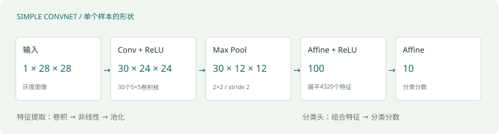
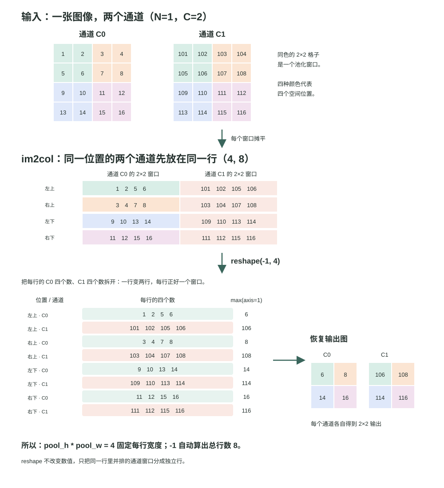
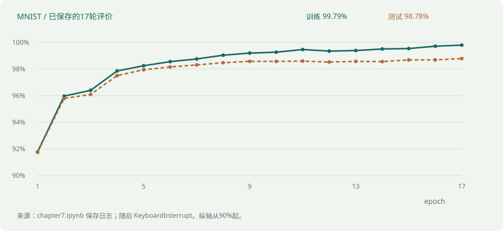

# 第7章：卷积神经网络

[返回学习导航](00-学习导航.md) · [上一章](06-与学习相关的技巧.md) · [图解速查](../../reference/chapter7.html) · [自己的 Notebook](../../mycode/chapter7.ipynb)

> 本章主线：**窗口提取局部信息 → 矩阵乘法批量计算 → 反向汇合梯度 → 用分类损失更新参数。**
>
> 整理于2026-11-13，覆盖已读的7.1—7.5。Notebook保存17轮日志，随后KeyboardInterrupt；当前源码已设为20轮。7.6之后尚未确认阅读。

## 先用一张图串起来



图中省略批次轴N。当前网络是：

```text
输入 → Conv1 → ReLU1 → Pool1 → Affine1 → ReLU2 → Affine2 → 分数
                                                        ↓
                                             SoftmaxWithLoss → 损失
```

`predict(x)`返回分数；`loss(x,t)`才连接SoftmaxWithLoss。分类准确率可以直接对分数取argmax，不必先转成概率，因为softmax不改变类别大小顺序。

## 7.1 整体结构：CNN新增了什么

全连接层把一张图展平后统一处理，连接权重不显式利用原来的局部空间关系。卷积层让相邻像素在窗口内一起参与计算，并让同一组权重在不同位置复用。

| 层 | 做什么 | 是否有可学习参数 | 是否改变形状 |
| --- | --- | --- | --- |
| Convolution | 局部窗口加权求和 | W、b | 由核数、窗口、步幅、填充决定 |
| ReLU | 负值归零，引入非线性 | 无 | 不改变 |
| Max Pooling | 每个通道内取局部最大值 | 无 | 通常缩小高宽，通道数不变 |
| Affine | 组合输入特征，生成新特征或分数 | W、b | 改变每个样本的特征维度 |

CNN并没有抛弃第5章的训练框架：前向得到损失，反向得到梯度，优化器再更新参数。池化层可省略，靠近输出仍可使用全连接层。

主教材：[7.1，图7-1与7-2](<../../materials/深度学习入门：基于Python的理论与实现 (斋藤康毅).pdf#page=226>)。

## 7.2 卷积层：先理解一个输出值

### 一个窗口的计算

```text
输入窗口       卷积核
1  2           1   0
3  4           0  -1

输出 = 1×1 + 2×0 + 3×0 + 4×(-1) + b
     = -3                 （取b=0）
```

在下一个位置，换一块输入窗口，仍使用同一个核。窗口内是对应位置相乘再求和，不是把两个2×2数组直接做矩阵乘法。教材代码不先翻转核，按严格数学定义属于互相关；深度学习中通常仍称卷积。

### 通道与卷积核数不要混淆

| 名称 | 记号 / 形状 | 含义 |
| --- | --- | --- |
| 输入 | `(N,C,H,W)` | N个样本，每个有C个通道 |
| 卷积核 | `(FN,C,FH,FW)` | FN个核，每个覆盖全部C个输入通道 |
| 偏置 | `(FN,)` | 每个输出通道一个，空间位置共享 |
| 输出 | `(N,FN,OH,OW)` | 一个核生成一个输出通道 |

例如RGB输入C=3，一个5×5核实际有`3×5×5=75`个权重。30个核共有2250个权重、30个偏置，产生30个输出通道。**核的输入通道数C必须匹配输入，核数FN决定输出通道数。**

### Padding与Stride决定窗口能放多少次

- Padding P：在高宽边缘各补P圈零，扩大边界处可覆盖的范围。
- Stride S：窗口每次移动S格，决定输出位置间隔。

```text
OH = (H + 2P - FH) // S + 1
OW = (W + 2P - FW) // S + 1
```

这里按`im2col`的整数除法计完整窗口。当前网络H=W=28、FH=FW=5、P=0、S=1，所以OH=OW=24。若改成P=2、S=1，则高宽保持28。

主教材：[7.2卷积层](<../../materials/深度学习入门：基于Python的理论与实现 (斋藤康毅).pdf#page=228>)。尺寸计算可对照[自己的窗口工具](../../mycode/common/util.py)。

## 7.3 池化层：每个通道独立缩小

最大池化在每个窗口取最大值，通道之间不求和。2×2、stride=2时，24×24变为12×12，30个通道仍是30个。

池化对窗口内小幅位置变化具有一定鲁棒性：只要最大值仍在同一窗口，输出就不变。它不保证任意平移后输出都相同。

池化没有W、b，但需要记录最大值来自哪里，反向时才能把损失梯度继续传给前面的卷积层。

## 7.4 实现：从窗口到矩阵，再从梯度回窗口

### 7.4.1—7.4.3 im2col与卷积前向

im2col按“样本 → 输出位置 → 通道 → 窗口元素”的逻辑排列数据。**一行是一个空间位置上、跨全部输入通道的窗口。**相邻窗口可能重叠，因此原图中的元素会被复制到多行。

```text
输入 x            (N, C, H, W)
窗口 col          (N*OH*OW, C*FH*FW)
卷积核 W          (FN, C, FH, FW)
展开的核 col_W    (C*FH*FW, FN)
矩阵乘法结果      (N*OH*OW, FN)
最终输出          (N, FN, OH, OW)
```

Notebook的两个输出可以自己算出来：

| 输入 / 窗口 | 输出位置 | 每行长度 | col形状 |
| --- | --- | --- | --- |
| `(1,3,7,7)` / 5×5，S=1，P=0 | 1×3×3=9 | 3×5×5=75 | `(9,75)` |
| `(10,3,7,7)` / 同上 | 10×3×3=90 | 75 | `(90,75)` |

```python
col = im2col(x, FH, FW, self.stride, self.pad)
col_W = self.W.reshape(FN, -1).T
out = np.dot(col, col_W) + self.b
out = out.reshape(N, out_h, out_w, FN).transpose(0, 3, 1, 2)
```

`W.reshape(FN,-1)`让每个核占一行，转置后一个核占一列。一行窗口乘一列核，得到该位置、该核的输出。偏置`(FN,)`广播到每一行。

结果先恢复为`(N,OH,OW,FN)`，再把FN移到通道轴；**reshape负责分组，transpose负责轴顺序。**只reshape成`(N,FN,OH,OW)`会把元素排错。

这种实现将大量窗口计算交给NumPy矩阵乘法，代价是展开窗口占用额外内存。具体排列见[作者im2col](https://github.com/oreilly-japan/deep-learning-from-scratch/blob/master/common/util.py)，本项目使用[自己的util.py](../../mycode/common/util.py)。

### 卷积反向：复用Affine的矩阵求导

前向是`Y = A @ B + b`，A=col，B=col_W。先把输出梯度转换为与Y相同的二维排列，记为G：

```python
FN, C, FH, FW = self.W.shape
G = dout.transpose(0, 2, 3, 1).reshape(-1, FN)

self.db = G.sum(axis=0)
dcol_W = self.col.T @ G
self.dW = dcol_W.T.reshape(FN, C, FH, FW)
dcol = G @ self.col_W.T

dx = col2im(dcol, self.x.shape, FH, FW, self.stride, self.pad)
```

| 梯度 | 形状核对 | 直观解释 |
| --- | --- | --- |
| db | `(FN,)` | 一个偏置被多处使用，各处贡献相加 |
| dcol_W | `(C*FH*FW,FN)` | 各窗口对同一核权重的贡献相加 |
| dW | `(FN,C,FH,FW)` | 把展开权重的梯度恢复成原参数排列 |
| dcol | `(N*OH*OW,C*FH*FW)` | 通过核权重，把上游梯度传回每个窗口 |
| dx | `(N,C,H,W)` | 各窗口梯度汇合到原输入位置 |

前向缓存`x、col、col_W`，分别用于输入形状恢复、权重梯度和窗口输入梯度。这里`dout`是损失对层输出的梯度，不是预测值或参数的更新量。

### col2im为什么要累加

用一维重叠窗口看最清楚：

```text
输入          [a, b, c]
窗口1         [a, b]    收到窗口梯度 [1, 2]
窗口2            [b, c] 收到窗口梯度 [3, 4]
汇回输入      [1, 5, 4]          b的贡献：2+3
```

一个变量通过多条路径影响损失，梯度需要求和。因此`col2im(im2col(x))`在有重叠时不会直接等于x，而会把重复出现的值累加；它在反向中用于汇回窗口梯度。

对照[自己的Convolution.backward](../../mycode/chapter7.ipynb)、[Affine公式](../../reference/affine-backward.html)和[作者层实现](https://github.com/oreilly-japan/deep-learning-from-scratch/blob/master/common/layers.py)。

### 7.4.4 池化reshape：一行只放一个通道的窗口



```python
col = im2col(x, pool_h, pool_w, stride, pad)
col = col.reshape(-1, pool_h * pool_w)
arg_max = np.argmax(col, axis=1)
out = np.max(col, axis=1)
out = out.reshape(N, out_h, out_w, C).transpose(0, 3, 1, 2)
```

| 步骤 | 形状 | 每行是什么 |
| --- | --- | --- |
| im2col后 | `(N*OH*OW,C*PH*PW)` | 一个位置，所有通道的窗口 |
| reshape后 | `(N*OH*OW*C,PH*PW)` | 一个位置，一个通道的窗口 |
| max后 | `(N*OH*OW*C,)` | 每个窗口的一个最大值 |
| 恢复输出 | `(N,C,OH,OW)` | 各样本、各通道的输出特征图 |

图中N=1、C=2、输入4×4，窗口2×2、S=2：`(4,8) → (8,4) → (8,) → (1,2,2,2)`。`-1`自动推导窗口行数；它不表示“压掉通道”，通道只是被临时并入行数。

### 池化反向：argmax记录路线

```text
前向窗口      [1, 5, 2, 3] → 5，arg_max=1
上游梯度      2
窗口内梯度    [0, 2, 0, 0]
```

```python
dout = dout.transpose(0, 2, 3, 1)
pool_size = self.pool_h * self.pool_w
dmax = np.zeros((dout.size, pool_size))
dmax[np.arange(self.arg_max.size), self.arg_max] = dout.flatten()
dcol = dmax.reshape(dout.shape[0] * dout.shape[1] * dout.shape[2], -1)
dx = col2im(dcol, self.x.shape,
            self.pool_h, self.pool_w, self.stride, self.pad)
```

`np.arange(...)`给出行号，arg_max给出各行的列号；配对索引只在被选中的位置填入梯度。最大值并列时，当前实现采用argmax返回的第一个位置。若池化窗口重叠，汇回输入时同样累加。

当前Pooling输出尺寸公式没有包含pad，按pad=0使用；网络采用2×2、stride=2。教材位置：[7.4.4，书内223页](<../../materials/深度学习入门：基于Python的理论与实现 (斋藤康毅).pdf#page=248>)，也可做[池化短课](../../lessons/0016-pooling-window-reshape.html)。

## 7.5 SimpleConvNet：把层组装成网络

### 输出与参数形状总表

| 位置 | 输出形状 | 参数形状 / 数量 |
| --- | --- | --- |
| 输入 | `(N,1,28,28)` | 无 |
| Conv1 → ReLU1 | `(N,30,24,24)` | W1 `(30,1,5,5)`，b1 `(30,)`；780个 |
| Pool1 | `(N,30,12,12)` | 无 |
| Affine1内部展平 | `(N,4320)` | 30×12×12=4320 |
| Affine1 → ReLU2 | `(N,100)` | W2 `(4320,100)`，b2 `(100,)`；432100个 |
| Affine2 | `(N,10)` | W3 `(100,10)`，b3 `(10,)`；1010个 |

总参数433890个，其中大部分在Affine1。卷积虽然输出许多空间位置，但同一核共享参数，参数量不乘OH×OW。各组梯度与参数同形。

Affine前向保存`original_x_shape`，再展平；反向先算二维dx，再恢复原四维形状，才能传给Pool1。实现见[common/layers.py](../../mycode/common/layers.py)。

### 三个方法是一条调用链

```text
predict(x)       顺序forward → 分类分数
loss(x,t)        predict → SoftmaxWithLoss → 标量损失
gradient(x,t)    loss建立缓存 → 损失层backward(1)
                → 各层逆序backward → 收集六组参数梯度
外部训练循环     params[key] -= learning_rate * grads[key]
```

gradient仍经过没有参数的ReLU和Pooling，否则梯度无法传回Conv1。只有Conv1、Affine1、Affine2提供W和b的梯度。

层对象和`network.params`持有同一参数数组，所以原地`-=`会同步更新层看到的参数；如果只把字典键重新绑定到一个新数组，层可能仍引用旧数组。作者结构可对照[SimpleConvNet](https://github.com/oreilly-japan/deep-learning-from-scratch/blob/master/ch07/simple_convnet.py)。

### Python细节：默认字典为什么用None

```python
def __init__(self, conv_param=None):
    if conv_param is None:
        conv_param = {"filter_num": 30, "filter_size": 5,
                      "pad": 0, "stride": 1}
```

可变默认参数在函数定义时只创建一次，可能被多次调用共享。在内部新建字典，让省略参数的每次调用独立。整数和元组等不可变默认值不属于这一问题。

## 训练循环：一批、一次更新、一轮

### 数据接口

```python
(x_train, t_train), (x_test, t_test) = load_mnist(
    normalize=True, flatten=False, one_hot_label=True
)
```

`flatten=False`保留四维图像；归一化使像素缩放到0—1。当前损失层反向按one-hot实现，所以显式请求one-hot标签。准确率函数沿axis=1分别把分数与one-hot标签转成类别编号，累计正确数，再除以总样本数。

### 一轮内部发生什么

```text
permutation打乱全部样本编号
    ↓ 每批使用同一组编号同时取图像与标签
求梯度 → SGD原地更新 → 记录更新后当前batch损失
    ↓ 所有批次完成
分批评价整个训练集、测试集 → 打印这一轮日志
```

当前每轮遍历一次全部训练样本，不放回地覆盖每个样本。每批求梯度期间固定数据，完成更新后再换下一批。

| 名称 | 当前循环中的含义 | 全量60000张、batch=100 |
| --- | --- | --- |
| iteration | 一个批次求导并更新一次 | 1次更新 |
| epoch | 遍历全部训练样本一次 | 600次更新 |
| 当前源码epochs=20 | 计划20次完整遍历 | 12000次更新（计划） |

重新运行包含`network=SimpleConvNet()`的训练格会重新初始化，并清空历史列表，不会自动从中断位置续训。第一条日志要等600次更新和训练/测试集评价结束才出现。

### 日志指标的含义

- `train_loss_list`：每次更新后、当前批次的损失。
- 打印的`batch loss`：该轮最后一批更新后的损失，**没有对整轮求平均**。各轮最后一批不同，起伏不等于整个网络突然变差。
- `train_acc_list/test_acc_list`：每轮结束、使用同一轮更新后参数评价的全量准确率。

## 本次实验：保存了17轮，随后中断



数据直接来自Notebook保存输出，未重新运行训练。

| 保存日志 | batch loss | train acc | test acc | 训练−测试差 |
| --- | --- | --- | --- | --- |
| 第1轮 | 0.2299 | 91.77% | 91.73% | 0.04个百分点 |
| 第5轮 | 0.0340 | 98.24% | 97.94% | 0.30个百分点 |
| 第10轮 | 0.0078 | 99.26% | 98.57% | 0.69个百分点 |
| 第17轮 | 0.0019 | 99.79% | 98.78% | 1.01个百分点 |

前几轮训练与测试准确率都明显提高。后段训练仍提高，测试提升放缓，二者差距扩大。这个趋势值得观察，但不能只凭末批loss或一个评价点判断过拟合，也不能用这一次实验单独解释哪个设计贡献了多少提升。

**运行记录与当前配置分开看：**保存日志写着`epoch 1/50`至`17/50`，随后错误类型为`KeyboardInterrupt`；当前单元格源码是`epochs=20`，执行计数为null。这里只确认存在17轮完整日志，不推断之后是否重跑或20/50轮已经完成。

自己的配置为SGD、lr=0.1、batch=100，每轮评价全量60000/10000张图。作者[训练脚本](https://github.com/oreilly-japan/deep-learning-from-scratch/blob/master/ch07/train_convnet.py)使用Adam、lr=0.001、20轮，每轮评价1000个样本；优化器和评价开销不同，不要求曲线和耗时一致。

## 回查入口与下一步

| 卡住的地方 | 从哪里看 |
| --- | --- |
| CNN为什么还有Affine | [结构短课](../../lessons/0015-cnn-overview.html) |
| 池化reshape每行是什么 | [池化窗口短课](../../lessons/0016-pooling-window-reshape.html) |
| 梯度如何从矩阵传回图像 | [卷积反向速查](../../reference/chapter7.html#convolution-backward) |
| epoch与更新次数混淆 | [训练日志短课](../../lessons/0017-cnn-epoch-updates.html) |

可选回忆：输入`(2,3,7,7)`、核`(4,3,5,5)`、S=1、P=0时，col、col_W和最终输出各是什么形状？先自己算，再展开核对。

<details><summary>核对形状</summary><p>OH=OW=3；col=(18,75)，col_W=(75,4)，最终输出=(2,4,3,3)。18=2×3×3，75=3×5×5，输出通道数来自核数4。</p></details>

把自己的思路或没看懂的代码发给我，我们继续拆解。下一节按教材进入7.6「CNN的可视化」；以上练习可按需选择，运行成功不等于已独立掌握推导。

## 来源与代码

- [本地主教材](<../../materials/深度学习入门：基于Python的理论与实现 (斋藤康毅).pdf>)：第7章7.1—7.5的概念主线。
- [自己的Notebook](../../mycode/chapter7.ipynb)：本笔记的实现、当前配置和17轮保存输出。
- [自己的窗口工具](../../mycode/common/util.py)与[公共层](../../mycode/common/layers.py)：im2col/col2im和Affine形状恢复。
- 上文各节链接到作者对应实现，便于对照；本笔记未推进7.6之后的阅读记录。
